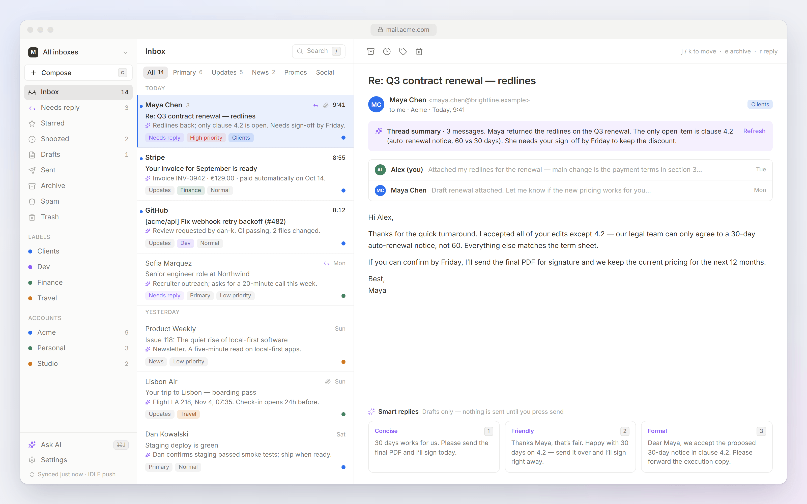
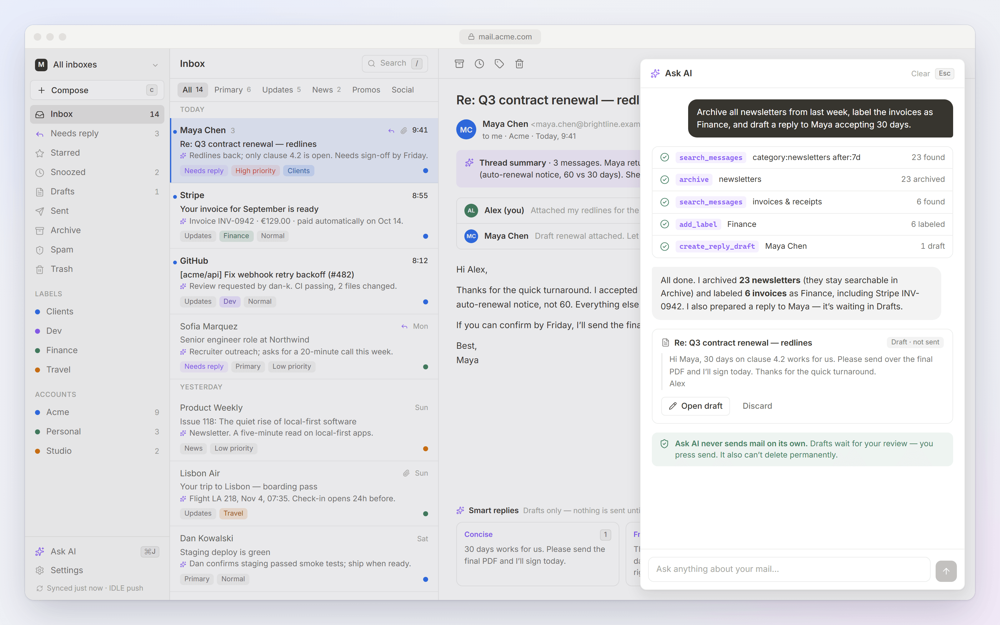
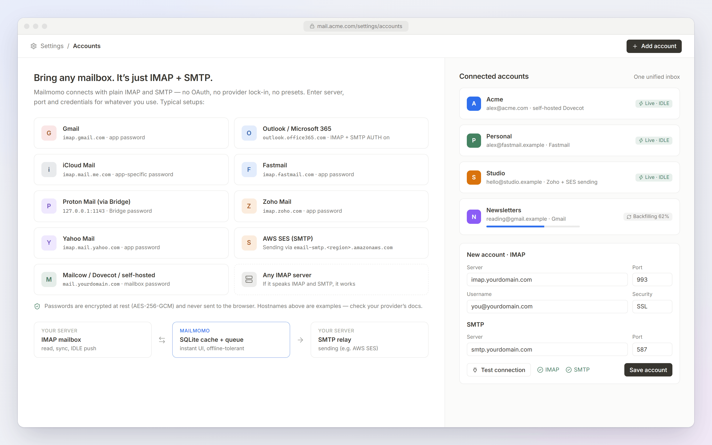
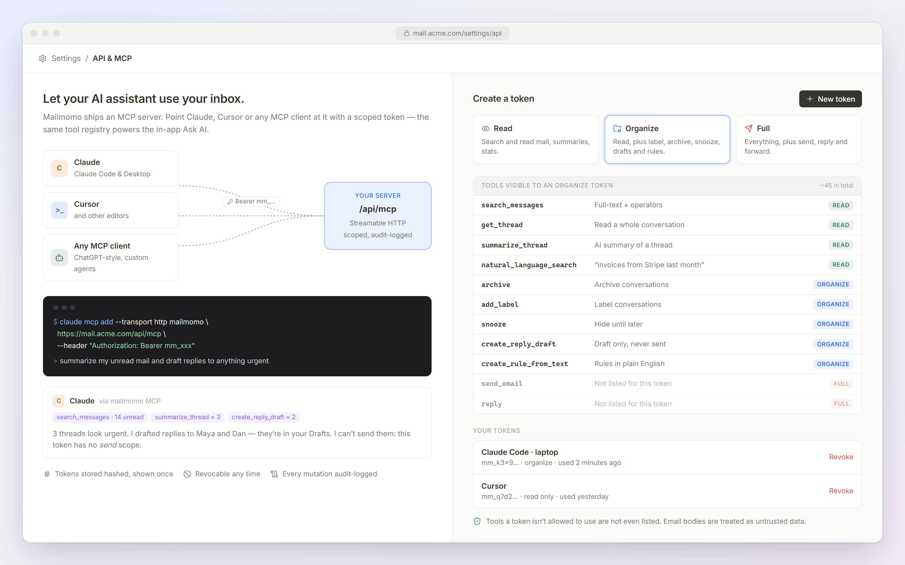

<h1 align="center">Mailmomo</h1>
<p align="center"><b>The calm, AI-native email client you self-host.</b><br>
Any IMAP/SMTP account · keyboard-first · built-in MCP server · your server, your data.</p>
<p align="center">
  <a href="LICENSE"></a>
  
  
</p>



> Superhuman speed · Notion calm · your server, your data.

It talks to your own **IMAP** server and sends through your own **SMTP** (e.g. **AWS SES**), keeps a fast local cache in
SQLite, and exposes everything to your own AI assistant through an **MCP server**.

## What you get

**Mail**
- Any number of IMAP/SMTP accounts — Gmail, Outlook/365, iCloud, Fastmail, Proton Bridge, SES, self-hosted… ([setup guide](docs/guides/accounts.md)) — unified inbox or per-account view
- Real two-way sync: IMAP IDLE push, CONDSTORE flag sync, expunge detection, UIDVALIDITY handling, background backfill of the whole mailbox
- Optimistic, offline-tolerant actions: every change applies instantly and replays to the server through a durable queue
- Conversation threading (Message-ID / References / subject fallback)
- Search: full-text (SQLite FTS5) + operators — `from: to: subject: has:attachment is:unread is:starred label: category: in: after: before: -from:`
- Compose in a floating window: rich text, Cc/Bcc, contact autocomplete, attachments (drag & drop), autosave, signatures,
  **undo send** (server-side), **send later**, reply / reply-all / forward with quoted history
- Mail you send is appended to your IMAP *Sent* folder (SES doesn't store it)
- Snooze, star, archive, trash, spam, move, labels, unsubscribe, split inbox by category

**AI at the core** (set `LLM_API_KEY`; everything degrades gracefully without it)
- Auto-triage on arrival: category, priority, one-line summary, "needs reply", labels
- Thread summaries · three-tone smart reply drafts · "write this email for me" · rewrite / shorten / fix grammar
- Natural-language search ("invoices from Stripe last month") and natural-language rules ("archive anything from github.com and label it Dev")
- Inbox clean-up suggestions, and an **Ask AI** assistant (⌘J) that searches, labels, archives and drafts — but **never sends**



**Automation**: rules on incoming mail (label / archive / mark read / star / trash / move / categorize), run retroactively.

**Superhuman-style speed**: `j/k` `e` `#` `s` `u` `h` `l` `r` `a` `f` `c` `/` `z` `g i` … plus a ⌘K command palette. Press `?` in the app.

**MCP server** (`/api/mcp`, Streamable HTTP): ~45 tools — list/search/read, summarize, label, archive, snooze, drafts, rules,
and (with a *send* token) send/reply/forward. See [MCP](#mcp--your-ai-assistant).



## Quick start

Requires **Node.js 22.13+** (SQLite is Node's built-in `node:sqlite`, so there is nothing native to compile — works the same on Windows, macOS and Linux).

```bash
npm install
cp .env.example .env.local       # set BETTER_AUTH_URL, optionally LLM_API_KEY
npm run dev                      # http://localhost:3000
```

1. Open the app — the **first account you create becomes the owner**; sign-up then closes.
2. Add your mailbox (IMAP host, SMTP host, credentials). *Test connection* tells you exactly what's wrong.
3. Mail starts appearing within seconds; older mail backfills in the background.

**AWS SES**: SMTP host `email-smtp.<region>.amazonaws.com`, port `587` (STARTTLS) or `465` (SSL), username/password are your
*SMTP credentials* (not IAM keys). Your sender address/domain must be verified in SES.

### Production

```bash
npm run build && npm start        # or: docker compose up -d   (app + optional Redis)
```
Put it behind HTTPS (Caddy/nginx/Traefik) and set `BETTER_AUTH_URL=https://mail.example.com`. Back up `DATA_DIR`
(default `./data`, `/data` in Docker): it holds the SQLite database, generated secrets and pending uploads.
Run **one** app instance per `DATA_DIR` (SQLite + one IMAP connection per account); Redis is only needed to fan live
updates out if you do run several processes.

## Architecture

```
Browser (Next.js app, TanStack Query cache, SSE)  ─┐
AI assistant ── MCP (/api/mcp, bearer token) ──────┤
                                                   ▼
                       server/tools.ts  (one tool registry: MCP + in-app agent)
                                                   ▼
                       server/mail/service.ts  (the only place mail is read/mutated)
              ┌────────────────┬───────────────────┼───────────────────┐
              ▼                ▼                   ▼                   ▼
        SQLite + FTS5     ops queue → IMAP     SMTP (nodemailer)   AI (Anthropic)
        (read model)      (sync.ts, IDLE)                          triage / agent
```

- `src/server/mail/sync.ts` — per-account loop: connect → folders → drain pending ops → new mail → flags → expunges → backfill → IDLE.
- `src/server/mail/ingest.ts` — parse, sanitize HTML, thread, categorize heuristically, run rules, harvest contacts.
- `src/server/ai/*` — model client (swappable transport), triage worker, features, agent loop.
- `src/server/worker.ts` — started from `instrumentation.ts`: sync, send queue (undo/schedule), snooze wake-ups, AI triage.
- Auth: **better-auth** (email + password, httpOnly cookies, session management, rate limiting).

Full design notes: [`docs/architecture/plan.md`](docs/architecture/plan.md).

## MCP — your AI assistant



Settings → **API & MCP** → create a token. Scopes: **read** (search & read), **organize** (+ label/archive/snooze/draft/rules),
**full** (+ send). Tokens are stored hashed, shown once, revocable, and every mutation is audit-logged.

```bash
claude mcp add --transport http mailmomo https://mail.example.com/api/mcp \
  --header "Authorization: Bearer mm_xxx"
```

Tools include: `list_messages`, `search_messages`, `get_message`, `get_thread`, `inbox_stats`, `summarize_thread`,
`natural_language_search`, `mark_read/unread`, `star`, `archive`, `trash`, `mark_spam`, `move_to_folder`, `snooze`,
`add_label`, `create_draft`, `create_reply_draft`, `draft_reply_with_ai`, `create_rule(_from_text)`, `cleanup_suggestions`,
`send_email`, `send_draft`, `reply`, `forward`, … Tools a token isn't allowed to use are not even listed.
Email bodies are treated as untrusted data in all prompts.

## Security model

- Everything behind a session (or scoped token); every query is scoped to the owning user; sign-up closed after the owner.
- IMAP/SMTP passwords encrypted at rest (AES-256-GCM, key from `MASTER_KEY` or auto-generated in `DATA_DIR`), never sent to the browser.
- HTML mail is sanitized server-side and rendered in a **script-less sandboxed iframe with its own CSP**; remote images
  (tracking pixels) are blocked until you allow them (per message or per sender).
- CSRF: SameSite cookies + Origin checks on state-changing requests; strict security headers (CSP, frame-ancestors none, nosniff…).
- Attachments are served with `nosniff`, a sandboxing CSP, and only safe types inline.
- The in-app AI cannot send mail or delete permanently; MCP send requires an explicit *send* token.
- Account setup refuses link-local/cloud-metadata hosts. TLS is verified unless you opt out per account.
- The browser caches **list metadata only** (subjects/snippets) in localStorage for instant start; set
  `NEXT_PUBLIC_PERSIST_CACHE=false` at build time to disable. It is cleared on sign-out.

## Testing

```bash
npm test            # unit + integration (real Dovecot IMAP server + SMTP sink) + MCP/AI tests (47 tests)
npm run test:e2e    # Playwright against a production build, real IMAP/SMTP, mocked model (19 flows)
npm run check       # typecheck + lint + tests
```
The integration/e2e suites (Linux/macOS/WSL only) use `scripts/devmail.mjs`, which boots a throw-away Dovecot (`apt install dovecot-imapd`) and a
tiny SMTP "MTA" delivering into it. `npm run devmail` starts it for manual play (alice@test.local / pass, IMAP :11143, SMTP :11025).
`MAILMOMO_AI_MOCK=1` swaps the model for a deterministic fake so AI flows are testable offline — never set it in production.

## Known limits (v1)

- Drafts, snoozes and labels are stored locally (not as IMAP drafts/keywords); mail itself is always on your IMAP server.
- Messages above ~4 MB are fetched truncated for the cache (attachments still download in full on demand).
- `<style>` blocks in marketing emails are dropped by the sanitizer (inline styles are kept).
- AI triage only runs on mail from the last 14 days to keep costs predictable.
- Password auth only (better-auth supports passkeys/2FA plugins if you want them added).

## Documentation
- [Connecting accounts](docs/guides/accounts.md) · [Self-hosting](docs/guides/self-hosting.md) · [Architecture](docs/architecture/plan.md)
- [Contributing](CONTRIBUTING.md) · [Security policy](SECURITY.md) · [Changelog](CHANGELOG.md)

## License
Mailmomo is open source under the [GNU AGPL-3.0](LICENSE). The `ee/` directory is reserved for future commercial
features under a separate license ([`ee/README.md`](ee/README.md)); the core in this repository stays AGPL.
For a commercial license of the core (e.g. to embed it without AGPL obligations), contact the maintainer via GitHub.
